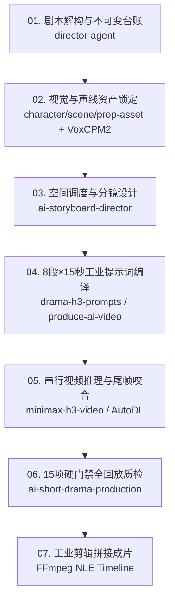

# 🎬 AI Drama Suite (AI 短剧工业级生产工作流)

[](https://opensource.org/licenses/MIT)
[](#-快速安装)
[](#-模型适配)

面向 AI 短剧、漫剧、长篇剧情短视频的**全流程工业级生产技能套件**。  
融合**好莱坞视听控制论**与**一线实战工程铠甲**，将“玄学抽卡”转化为“可确定、可复现、可串行接力”的工程交付。

---

## 🌟 核心突破：一线实战十大约束铁律与控制契约

相比传统宽泛的 AI 影视 Prompt，本套件内置了经过真机压测、逐秒复盘沉淀的一线实战强约束协议：

1. **🎙️ 声线锚定资产系统（`voice_anchor_contract`）**：
   - 强制出场主角绑定实物标准 WAV 文件（如 `VoxCPM2_EN/normalized/`）；
   - 提示词中映射 `<Audio 1>` ➔ `ref_audio_0`，**全剧角色音色绝对连续，彻底杜绝跨段变声**。

2. **🔇 配乐静音隔离协议（`audio_silence_contract`）**：
   - 强制将模型配乐参数设为 `non_diegetic_music: SILENT`；
   - 视频模型仅生成现场物理音效（`overall_soundscape`：雨声、脚步、碰撞、喘息）；
   - 配乐留待后期剪辑台全局混音通铺，**根治分段视频拼接时的断崖式跳音与杂音**。

3. **📜 不可变台词防篡改台账（`immutable_dialogue_ledger`）**：
   - 锁定剧本原始台词，建立不可变哈希台账；
   - 100% 逐字对应 `<d>[Language] ...</d>`，严禁 AI 擅自扩写、意译或删词；
   - 强制说话秒数内面部/口型可见，背身或画外必须声明 `[Off-Screen]`。

4. **🔬 资产分级绑定与局部法线死锁（`asset_granularity_tiering`）★**：
   - 微距与特写镜头（如手掌印记、面部伤痕、手持小道具）**严禁混用全身立绘混充**，必须绑定局部专属资产卡；
   - 显式锁死机位法线（如正对内侧掌心）并声明未异变周边肢体保持 100% 正常人类皮肤，**彻底杜绝全身变异向手臂蔓延的畸变 Bug**。

5. **⏳ 视听因果递进法则（`timeline_causality_protocol`）★**：
   - 严格遵循**“先动作 ➔ 后视线 ➔ 再发问”**时序链条；
   - 微时序中主动方先展开道具/完成动作，次角色视线聚焦震惊后才张嘴发问，**根绝未见先知、抢拍说话的时间轴倒置**。

6. **🤐 画面主控与非发声者闭嘴死锁（`speaker_facing_muzzle_lock`）★**：
   - 当前发声角色面部必须占据画框主视觉机位；
   - 同画框所有非发声角色在提示词与负向中强制写死 `lips tightly pressed shut with zero mouth movement, silent listener`；
   - 副角色使用独立物理声学描述隔离，**彻底杜绝声音与嘴型张冠李戴、互相“夺舍”的恶性 Bug**。

7. **⚓ 第 0 秒实体常驻刚体法则（`anchor_zero_rule`）★**：
   - 凡是镜头中途被捡起、触碰或交互的道具，必须自 `00:00.000` 首帧起声明半埋或放置在场景绝对坐标中作为固定刚体常驻；
   - **严禁中途依赖扩散模型无中生有凭空刷新道具**。

8. **🔄 动作状态机闭环与换装跳切剪辑（`action_state_machine` & `match_cut`）★**：
   - 动作遵循 `Open ➔ Execute ➔ Close` 生命周期（如接打电话必须有拿起、通话、咔哒扣入基座的完整挂断动作）；
   - 角色更衣/变装**严禁在同一连续镜头内渐变**，必须在动作闭环后采用电影匹配剪辑（Match Cut）转入全副武装新镜头。

9. **⚡ 动作账本与刚体防回弹禁令（`action_ledger` & Anti-Bounce）**：
   - 动作拆解为 `起势 ➔ 位移 ➔ 接触/受力 ➔ 反应 ➔ 定格尾帧`；
   - 注入 Anti-Bounce 物理持续下压约束，彻底消除“踩脚后回弹重踩”、“肢体反复抽搐”等生成幻觉。

10. **🎯 导演预演强制审批门（`Director Previs Approval Gate`）**：
    - 编译六大模块机器提示词与调用算力前，强制交付【五列人读导演预演表】（时间、景别机位、动作因果、逐字台词、声音与尾帧）；
    - **用户未明确确认“通过”前，严禁擅自生成机器提示词、严禁调用付费渲染**，杜绝无效烧算力。

---

## 🏗️ 流水线架构（Pipeline Overview）



---

## 📦 技能模块清单 (20 Modules)

### 1. 核心生产管道 (Pipeline Core)
* **`director-agent`**：剧本三层读法、因果动作、潜台词分析、剧本诊断
* **`character-asset`**：角色资产合同、多角度定妆三视图、锁定特征库、人工审核门禁
* **`scene-asset`**：场景资产合同、空间锚点、光源与环境材质锁定
* **`prop-asset`**：核心道具合同、几何与物理交互校验、局部微距资产卡
* **`ai-storyboard-director`**：五列人读分镜表、180° 行动轴（`blocking_map`）、非等分时间轴与复合运镜
* **`ai-short-drama-production`**：微短剧总编排，统筹单集 8 段节拍、控制合同层与 15 项工业硬门禁 QC
* **`drama-h3-prompts`** *(★新收录)*：MiniMax H3 官方电影级短剧提示词生成器（8段 × 15秒 · 工业实战增强版）
* **`produce-ai-video`**：六大模块外层 ＋ 数字 10 内核提示词编译，成片验收与返工闭环

### 2. 类型视觉风格库 (Genre Modules)
* **`epic-design`**：史诗宏大、全景奇观、王朝帝国
* **`fantasy-design`**：暗黑奇幻、魔法古堡、巨龙巫师
* **`cyberpunk-design`**：赛博朋克、高密度未来都市、霓虹雨夜、义体机甲
* **`hard-sci-fi-visual-director`**：硬核科幻、工程机械、外星生态、FUI/HMI
* **`noir-design`**：黑色犯罪、冷调悬疑、高反差暗夜
* **`wuxia-design`**：东方武侠、江湖冷兵器、快意恩仇
* **`war-design`**：现代与未来战争、爆炸弹道、战地泥泞
* **`romance-design`**：浪漫爱情、柔光亲密、情绪细腻
* **`horror-design`**：惊悚怪兽、中式/西式恐怖、压迫氛围

### 3. 数据与工程支撑 (Analytics & Workbench)
* **`d-official-market-analysis`**：影视与微短剧官方大盘数据、热门题材与爆款趋势分析
* **`d-data-analysis-semantic-layer`**：市场分析数据语义层审核与版本化写入
* **`web-design-director`**：影视资产库与生产工作台 Web 前端视觉设计规范

---

## 🚦 生成前 15 项工业硬门禁（Gate Checks）

在任何提示词提交视频生成前，必须逐项核对以下 15 项硬门禁：

- [ ] **【前置锁死门禁】** 提示词首行已置顶 Master Rig Prefix，锁定焦段、光影色调与静态建筑几何刚性
- [ ] **【空间地标门禁】** 具备 2D 屏幕绝对坐标（screen-left/right）并包含 1~2 个具象刚性几何地标
- [ ] **【零秒常驻门禁】** 镜头中途被拾取/交互的道具，已在 00:00.000 作为客观刚体常驻场景坐标，严禁中途虚空生成
- [ ] **【单运镜门禁】** 每个微时序切片内严格执行单一主运镜，无多轴复合运镜冲突
- [ ] **【动作闭环门禁】** 交互动作具备完整生命周期（拿起-使用-放下/挂断），具有明确的结束态
- [ ] **【换装跳切门禁】** 角色更衣/换上重甲已拆分为独立镜头并使用硬切（Match Cut），绝不单镜头渐变换装
- [ ] **【时序因果门禁】** 台词严格落在“动作触发完成”与“倾听者视线注视反馈”之后，绝无未见先知的超前台词
- [ ] **【闭嘴死锁门禁】** 说话者占据主画框，同画幅非说话角色已显式声明“lips tightly pressed shut, silent listener”
- [ ] **【资产粒度门禁】** 特写与微距镜头已绑定专属局部微距资产卡，显式锁死拍摄法线并约束周边正常皮肤不异变
- [ ] **【闭环状态门禁】** 明确标注 Open State 与 Close State，实现尾首帧物理级咬合
- [ ] **【声线门禁】** 出场说话角色的专属 WAV 声线文件已在本地就绪，且在提示词中正确指派 `<Audio N>`，非主角声学隔离
- [ ] **【台词门禁】** 台词 100% 逐字匹配剧本不可变台账，口型可见性已通过校验（面部可见或声明画外）
- [ ] **【配乐门禁】** `non_diegetic_music` 严格锁定为 `SILENT`，无生成模型自造背景音乐
- [ ] **【调度与轴线门禁】** 调度图锁定 180° 轴线，摄影机与角色世界坐标一致，绝不跳轴
- [ ] **【接触物理门禁】** 脚底接触地面包含 Anti-Slide 防滑步约束，手部握持无穿模风险
- [ ] **【串行接力门禁】** 串行接力已锁定上一段 `-0.35s` 稳定尾帧为 `<Picture 1>`

---

## 🚀 快速安装 (Installation)

### 方式一：一键克隆安装至本地 Agent
将本仓库克隆到你的通用 Agent Skills 目录：

```bash
# Codex / Antigravity / 通用 Agents
git clone https://github.com/egguy886/ai-drama-suite.git ~/.agents/skills/ai-drama-suite

# 或克隆到当前项目工作区
git clone https://github.com/egguy886/ai-drama-suite.git .agents/skills/
```

### 方式二：使用内置安装器单模块安装
```bash
python scripts/install_skill.py ai-short-drama-production --platform trae
python scripts/install_skill.py ai-storyboard-director --platform codex
```

---

## 📄 开源许可证

本项目基于 [MIT License](LICENSE) 开源。欢迎 Star、Fork 并提交 PR！
