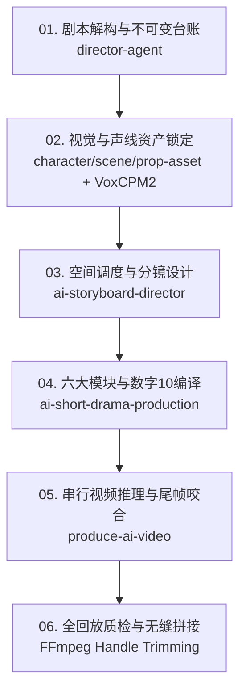

# 🎬 AI Film Skills Suite (AI 短剧与电影工业级生产技能套件)

[](https://opensource.org/licenses/MIT)
[](#-快速安装)
[](#-模型适配)

面向 AI 短剧、漫剧、长篇剧情短视频的**全流程工业级生产技能套件**。  
融合**好莱坞视听控制论**与**实战工程铠甲**，将“玄学抽卡”转化为“可确定、可复现、可串行接力”的工程交付。

---

## 🌟 核心突破：三大工业增强契约

相比传统宽泛的 AI 影视 Prompt，本套件内置了四大经过实战检验的强约束协议：

1. **🎙️ 声线锚定资产系统（`voice_anchor_contract`）**：
   - 强制出场主角绑定实物标准 WAV 文件（如 `VoxCPM2_EN/normalized/`）；
   - 提示词中映射 `<Audio 1>` ➔ `ref_audio_0`，**全剧角色音色绝对连续，彻底杜绝跨段变声**。

2. **🔇 配乐静音隔离协议（`audio_silence_contract`）**：
   - 强制将模型配乐参数设为 `non_diegetic_music: SILENT`；
   - 视频模型仅生成现场物理音效（`overall_soundscape`：雨声、脚步、碰撞、喘息）；
   - 配乐留待后期剪辑台全局混音通铺，**根治分段视频拼接时的断崖式跳音与杂音**。

3. **📜 不可变台词防篡改台账（`immutable_dialogue_ledger`）**：
   - 锁定剧本原始台词，建立不可变哈希台账；
   - 100% 逐字对应 `<d>[Language] ...</d>`，严禁 AI 擅自扩写、意译或删词；
   - 强制说话秒数内面部/口型可见，背身或画外必须声明 `[Off-Screen]`。

4. **⚡ 动作账本与刚体防回弹禁令（`action_ledger` & Anti-Bounce）**：
   - 动作拆解为 `起势 ➔ 位移 ➔ 接触/受力 ➔ 反应 ➔ 定格尾帧`；
   - 注入 Anti-Bounce 物理持续下压约束，彻底消除“踩脚后回弹重踩”、“肢体反复抽搐”等生成幻觉。

---

## 🏗️ 流水线架构（Pipeline Overview）



---

## 📦 技能模块清单 (19 Modules)

### 1. 核心生产管道 (Pipeline Core)
* **`director-agent`**：剧本三层读法、因果动作、潜台词分析、剧本诊断
* **`character-asset`**：角色资产合同、多角度定妆三视图、锁定特征库、人工审核门禁
* **`scene-asset`**：场景资产合同、空间锚点、光源与环境材质锁定
* **`prop-asset`**：核心道具合同、几何与物理交互校验
* **`ai-storyboard-director`**：五列人读分镜表、180° 行动轴（`blocking_map`）、非等分时间轴与复合运镜
* **`ai-short-drama-production`**：微短剧总编排，统筹单集 8 段节拍、动作账本与门禁 QC
* **`produce-ai-video`**：六大模块外层 ＋ 数字 10 内核提示词编译，成片验收与返工闭环

### 2. 类型视觉风格库 (Genre Modules)
* **`epic-design`**：史诗宏大、全景奇观、王朝帝国
* **`fantasy-design`**：暗黑奇幻、魔法古堡、巨龙巫师
* **`cyberpunk-design`**：赛博朋克、高密度未来都市、霓虹雨夜、义体机甲
* **`hard-sci-fi-visual-director`**：硬核科幻、工程机械、外星生态、FUI/HMI
* **`noir-design`**：黑色犯罪、冷调悬疑、高反差暗夜
* **`wuxia-design`**：东方武侠、江湖冷兵器、快意恩仇
* **`war-design`**：现代与未来战争、爆炸弹道、战地泥泞
* **`romance-design`**：浪漫爱情、柔光亲密、情绪细腻
* **`horror-design`**：惊悚怪兽、中式/西式恐怖、压迫氛围

### 3. 数据与工程支撑 (Analytics & Workbench)
* **`d-official-market-analysis`**：影视与微短剧官方大盘数据、热门题材与爆款趋势分析
* **`d-data-analysis-semantic-layer`**：市场分析数据语义层审核与版本化写入
* **`web-design-director`**：影视资产库与生产工作台 Web 前端视觉设计规范

---

## 🚀 快速安装 (Installation)

### 方式一：一键克隆安装至本地 Agent
将本仓库克隆到你的通用 Agent Skills 目录：

```bash
# Codex / Antigravity / 通用 Agents
git clone https://github.com/egguy886/ai-film-skills.git ~/.agents/skills/ai-film-skills

# 或克隆到当前项目工作区
git clone https://github.com/egguy886/ai-film-skills.git .agents/skills/
```

### 方式二：使用内置安装器单模块安装
```bash
python scripts/install_skill.py ai-short-drama-production --platform trae
python scripts/install_skill.py ai-storyboard-director --platform codex
```

---

## 📄 开源许可证

本项目基于 [MIT License](LICENSE) 开源。欢迎 Star、Fork 并提交 PR！
